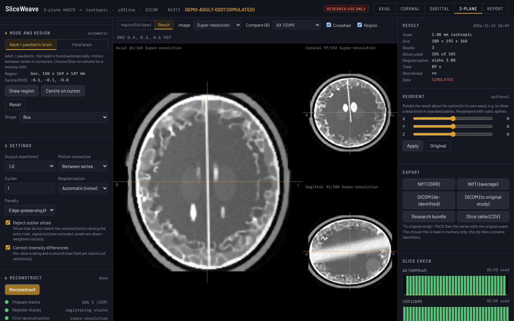
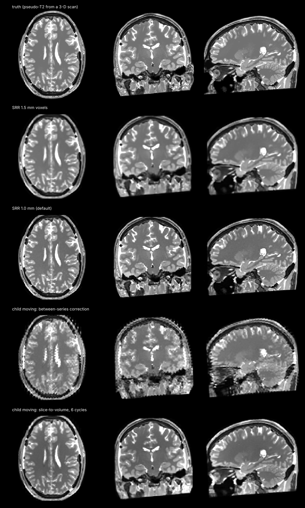
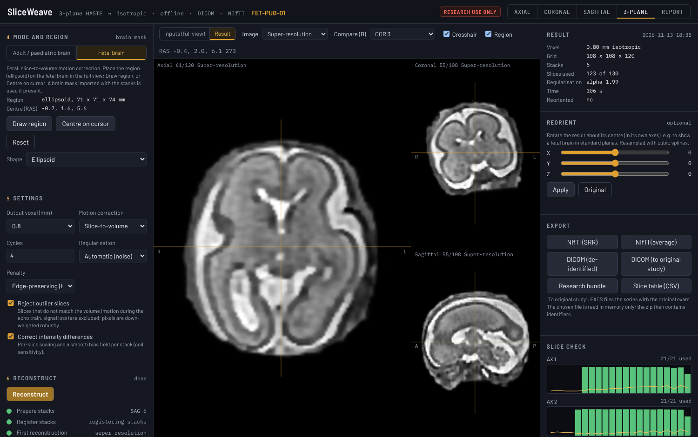

# SliceWeave

**Super-resolution reconstruction of 3-plane 2-D stacks into one isotropic volume**: single-shot
T2 (HASTE / SSFSE / SSh-TSE) for adult, paediatric and fetal brain MRI, and 2-D FLAIR for adult
and paediatric brain. A standalone, offline application: DICOM or NIfTI in, a
3-plane viewer, isotropic volume out as NIfTI or DICOM.

RESEARCH USE ONLY - NOT FOR CLINICAL DIAGNOSIS. Always compare the result with the acquired 2-D
series.



## Why

Single-shot T2 (HASTE / SSFSE / SSh-TSE) is acquired as thick 2-D slices because each slice
freezes motion. Three orthogonal stacks together sample the head at high resolution in every
direction; slice-to-volume and super-resolution reconstruction combine them into one isotropic
volume that can be reformatted in any plane.

The algorithms exist in research toolkits, mainly for fetal MRI: NiftyMIC (Ebner 2020), SVRTK
(Kuklisova-Murgasova 2012), MIALSRTK (Tourbier 2015), BTK (Rousseau) and NeSVoR (Xu 2023). They
are command-line tools working on NIfTI files, typically run on Linux or in Docker (NeSVoR needs
an NVIDIA GPU). SliceWeave is an independent, CPU-only implementation of the same framework,
packaged as one Windows executable with a local 3-plane viewer, DICOM and NIfTI input and output,
adult/paediatric and fetal presets, and the privacy model of the brain tumour workbenches
(offline, de-identified case store, research labels).

## Quick start

**Windows 10/11 (no installation):** download `SliceWeave.exe` from the
[Releases](https://github.com/laetissimus/slice-weave/releases) page, double-click it, and open
the login link it prints (the browser usually opens by itself). Data are kept in
`%USERPROFILE%\SliceWeave-Data`. `SliceWeave-portable.zip` is the same program as a folder that
starts faster (unzip, run `SliceWeave.exe` inside). Not code-signed: SmartScreen may ask for
"More info" -> "Run anyway". Builds of every push are also under Actions -> `windows-build` ->
artifact `SliceWeave-windows`.

**From source (Windows, macOS or Linux, Python 3.10+):**

```
pip install -r requirements.txt            # numpy, scipy, starlette, uvicorn, python-multipart
pip install pydicom python-gdcm            # optional: JPEG-compressed DICOM
python -m sliceweave serve                 # opens the viewer at http://127.0.0.1:8766
```

Try it without patient data: in the viewer, "Demo with simulated data" -> Adult, FLAIR or Fetal
demo, then Reconstruct.

## Workflow in the viewer

1. **Case**: a coded study ID (never an MRN or a name).
2. **Load stacks**: drop DICOM folders, zips or NIfTI files. HASTE-like 2-D series (HASTE,
   SSFSE, SSh-TSE, ...) are recognised and selected. NIfTI: a dcm2niix/BIDS JSON sidecar supplies
   the slice thickness; files named `*mask*` are used as brain masks for the stack with the same
   grid. Import de-identifies (see SECURITY.md).
3. **Stacks**: include/exclude, choose the reference stack (suggested: least motion; it sets the
   output orientation), check the slice thickness (it drives the slice profile).
4. **Mode and region**: *Adult / paed. T2* (single-shot; head found automatically, motion between
   series corrected), *2-D FLAIR* (see below), or *Fetal* (place the region on the fetal brain:
   Draw region, drag a box on any view of each orientation; or use brain masks). Warnings appear
   here when the selected series do not belong together (mixed contrasts, different TE/TR/TI,
   fewer than three planes).
5. **Settings**: output voxel size, motion correction (none / between series / slice-to-volume),
   cycles (rounds of motion correction, see [Cycles](#cycles)), regularisation (automatic from the noise, or a fixed alpha), outlier rejection,
   intensity correction.
6. **Reconstruct**, then review: Result vs any input stack (Compare, key B), slice check (which
   slices were used, how far each moved), report. Window: *Brain* (default) or *Full range*;
   right-drag adjusts width and level. Optional reorientation (rotate the volume about
   its centre, e.g. into fetal standard planes).
7. **Export**: NIfTI (SRR, average), DICOM de-identified, DICOM attached to the original study
   (choose one original image file; PACS files the series with that exam), research bundle
   (volumes, report.json, slices.csv).

## Cycles

A **cycle** is one round of: motion correction against the current reconstruction, intensity
correction (per-slice scale, smooth bias field per stack), the outlier-slice check, and a new
super-resolution solve. Each round registers the data to a sharper volume, so the motion
estimates and the volume improve together. Before the first cycle the series are registered once
to the reference stack; after the last cycle a longer final solve gives the output. Viewer:
Settings -> Cycles (0-8); command line: `--cycles N`.

| Motion correction | What one cycle corrects | Default |
|---|---|---|
| Between series (adult / paed. T2, FLAIR) | each whole series, re-registered to the latest volume | 1 |
| Slice-to-volume (fetal; optional for a moving child) | coarse to fine: cycle 1 whole stacks, then packets of slices acquired together (2, then 4 per stack); cycle 2 packets of 8, then single slices; cycle 3 and later single slices with less smoothing each round. From cycle 2 each slice's motion is smoothed over its neighbours in time; the fetal outlier threshold rises 0.5 -> 0.6 -> 0.7 over the first three cycles | 6 |
| None | cycles are not used | - |

With 0 cycles, or without motion correction, intensity correction and the outlier check still
run once (when switched on), but the series keep their first registration.

Effect on the phantoms (`python tools/validate.py --only cycles`; same stacks for every
setting; 2 CPU cores):

| Fetal phantom, slice-to-volume | 1 | 2 | 3 | 4 | **6** | 8 |
|---|---|---|---|---|---|---|
| PSNR (dB) / SSIM | 18.4 / 0.48 | 21.6 / 0.67 | 22.2 / 0.71 | 22.5 / 0.73 | **22.9 / 0.75** | 23.3 / 0.76 |
| slice position error (mm; 4.0 before) | 3.3 | 2.7 | 2.4 | 2.2 | **1.9** | 1.6 |
| slices used (of 169) | 84 | 149 | 151 | 151 | **155** | 155 |
| time (s) | 101 | 138 | 151 | 164 | **203** | 204 |

Without motion correction: 17.9 dB / 0.40; with the true motion: 25.5 dB / 0.79. On the adult
phantom (motion between series 1.6-3.5 deg, 1.3-1.6 mm) 0, 1, 2 and 3 cycles gave the same
result (22.5 / 22.5 / 22.4 / 22.3 dB, residual 0.03 deg / 0.03 mm): the first registration was
already accurate, and each extra cycle added about 17 s.

How to choose:

* **Adult / paediatric T2 and FLAIR:** keep 1. Use 2 if, in Compare (key B), an input series
  still looks shifted against the result after a large head movement between series.
* **Fetal:** keep 6; try 8 for strong motion (slightly better on the phantom at little extra
  time). Below 4, slice motion stays partly uncorrected; 1 cycle registers only packets of
  slices and drops half of them.
* More cycles do not repair a slice that is corrupted within itself (motion during its own echo
  train, signal loss); the outlier check excludes those.

## Grey-white matter and sulci (T2 / HASTE)

The cortical ribbon, the grey-white boundary and the sulci are 1-3 mm structures. With 3-5 mm
slices they appear only where the three orientations are combined accurately and not smoothed
away. What decides how they look, by size of effect (numbers: pseudo-T2 made from a real 0.88 mm
head scan, child protocol 0.6 x 0.6 x 3 mm; [docs/VALIDATION.md](docs/VALIDATION.md#grey-white-matter-and-sulci-pseudo-t2-from-the-real-head-scan)):

1. **Motion within a series.** A child who moves during a series smears and doubles the cortex in
   every plane, whatever the other settings. Signs: excluded slices (red) in the slice check,
   ragged edges, double contours. Choose Motion correction: *Slice-to-volume* (cycles go to 6).
   On a simulated moving child: slice position error 2.6 -> 0.2 mm, sulcal CSF contrast
   0.49 -> 0.87, SSIM 0.59 -> 0.91. If the reference stack lost many slices, choose the stack with
   the fewest as reference (the slice check suggests it): the others are registered to it.
2. **Output voxel.** Use 1.0 mm (default). 1.5 mm voxels average the cortex with CSF and white
   matter (cortex detail 0.91 vs 0.97 at 1.0 mm); a warning appears when the voxel is much coarser
   than the acquired in-plane resolution. 0.8 mm gave no more than 1.0 mm (a little more detail,
   more noise, 40 % more time); 0.5 mm has 8 x the voxels of 1.0 mm, takes correspondingly
   longer, and cannot add detail the 3 mm slices do not hold.
3. **Regularisation.** The final adult / paediatric T2 volume uses a quarter of the
   noise-calibrated weight (the volumes used for motion correction keep all of it). Against the
   full weight: sulcal CSF contrast 0.90 -> 1.01, cortex detail 0.955 -> 0.973, PSNR
   26.7 -> 27.7 dB, SSIM 0.93 -> 0.96 at 3 % noise, and better at 1.5 % and 6 % too; infant
   contrast (white matter brighter than grey) grey-white contrast 0.50 -> 0.64. For a sharper,
   noisier image set a manual alpha below the automatic one (shown in the report; a manual alpha
   also applies to the motion-correction volumes); Tikhonov is smoother.
4. **Display window.** Images open in a *Brain* window: centred on the brain tissue, so grey and
   white matter spread over the grey levels and CSF is near white. *Window: Full range* shows the
   whole intensity range; right-drag adjusts (left-right: width, up-down: level). DICOM exports
   carry the same brain window first and the full range second.
5. **Matching series.** Series with different TR / TE have different grey-white contrast; the
   reconstruction averages them. The plan warns when TE, TR or TI differ.

Limits: detail finer than the acquired in-plane resolution and the slice thickness allows cannot
be created; the low grey-white contrast of the unmyelinated infant brain is only partly
recovered from 3 mm slices (64 % on the simulation).



## 2-D FLAIR

Three orthogonal 2-D FLAIR series of one protocol (same TR, TE, TI) can be combined the same way.
FLAIR series are recognised by name (FLAIR, TIRM, dark fluid, ...), the Siemens `*tir2d` sequence,
or a long TI with a long TE; in a study with both single-shot T2 and FLAIR, the mode buttons switch
between them.

* **Motion between series only.** FLAIR is multi-shot: each slice is filled over the whole series,
  so it has no single position to correct. Slice-to-volume correction is not offered; exclude a
  series degraded by motion.
* **Acquired resolution.** FLAIR (like most clinical series) is often acquired at 256 x 192 and
  shown at 512 x 512. SliceWeave reads the acquired matrix from the DICOM header or the dcm2niix
  sidecar and models that resolution, not the pixel size (all modes). The stack table shows it.
* **Small lesions.** The FLAIR preset regularises the final volume less than the other modes to
  keep small hyperintensities, but on the FLAIR phantom lesions of 2-3 mm still keep only about
  40 % of their contrast (4 mm and larger: fully; docs/VALIDATION.md). Use the
  reconstruction for orientation and reformatting, read lesions on the acquired series, and do
  not count or measure lesions on it without your own validation. A 3-D FLAIR, when acquired, is
  better than any reconstruction from 2-D slices.
* Inflow and CSF-pulsation artefacts differ between planes; they are down-weighted, not removed.

## Command line

```
sliceweave recon --mode adult -o srr.nii.gz /path/to/dicom_folder
sliceweave recon --mode fetal --resolution 0.8 -o fetal_srr.nii.gz \
    run-1_T2w.nii.gz run-2_T2w.nii.gz ... run-1_mask.nii.gz ...
sliceweave recon --mode fetal --roi-center 12,-30,45 --roi-size 90,100,85 -o out.nii.gz stacks/*.nii.gz
sliceweave recon --mode flair -o flair_srr.nii.gz /path/to/study_folder   # uses the FLAIR series only
sliceweave simulate --kind fetal -o sim/        # phantom stacks with known truth (adult, flair, fetal)
sliceweave selftest [--full]                    # end-to-end checks on phantoms
sliceweave doctor                               # versions, disk encryption, network guard
```

Given a whole study, `recon` keeps the series of the chosen kind (single-shot T2, or FLAIR in
`--mode flair`) and lists the others. `SliceWeave.exe` accepts the same commands. `recon --dicom-out DIR` also writes a de-identified
DICOM series; `--report r.json` the full report.

## How it works (short)

Each slice is modelled as the volume blurred by a slice-oriented 3-D Gaussian point-spread
function (FWHM = slice thickness through-plane) and sampled at the slice's pixels after a rigid
motion correction. SliceWeave alternates motion estimation (stacks, then packets of slices
acquired together, then single slices, coarse to fine, with temporal repair and smoothing of the
slice motion) with super-resolution (edge-preserving regularised least squares, conjugate
gradients), per-slice intensity matching, bias-field correction and rejection of corrupted
slices. Details and references: [docs/METHODS.md](docs/METHODS.md).

## Validation

Summary (details, figures and how to reproduce: [docs/VALIDATION.md](docs/VALIDATION.md)):

| Case | Result |
|---|---|
| Adult phantom, 3 stacks 0.9 x 0.9 x 4 mm, motion between series | SRR PSNR 23.2 dB / SSIM 0.82, vs average of stacks 20.3 / 0.67 and one reformatted stack 20.0 / 0.63; series motion recovered to 0.03 deg / 0.03 mm |
| Same protocol simulated from a real 0.88 mm head scan | SRR 25.8 dB / 0.90, vs average 23.0 / 0.75 and one stack 22.3 / 0.72 |
| Pseudo-T2 from the real head scan, child protocol 0.6 x 0.6 x 3 mm | sulcal CSF contrast 1.01 and cortex detail 0.97 at 1.0 mm (1.5 mm voxels: 0.92 / 0.91); child moving during each series: slice-to-volume correction 2.6 -> 0.2 mm, SSIM 0.59 -> 0.91 |
| FLAIR phantom, 3 stacks 1.2 x 0.9 x 5 mm (zero-filled to 512), 12 lesions 2-8 mm | SRR 17.9 dB / 0.68 vs average 16.1 / 0.59 and one stack 15.7 / 0.51; contrast of 4-8 mm lesions fully recovered (one stack: 50-70 %), 2-3 mm lesions about 40 % (one stack: 16 %) |
| Fetal phantom, 6 stacks 1.1 x 1.1 x 3 mm, slice-by-slice motion | slice pose error 4.0 -> 1.9 mm; SRR 22.9 dB / 0.75 vs 17.9 / 0.40 without motion correction (true-motion upper bound 25.5 / 0.79) |
| Public fetal HASTE (6 stacks, 1.5 T) | median slice-to-volume NCC 0.69 -> 0.97, all 130 slices used, 2 min on 2 CPU cores |



These are software checks on simulated and public data, not a clinical validation.

## Limitations

* Fetal brain region: placed by the user or from masks made by another tool; no built-in
  automatic fetal brain detection yet.
* Rigid motion only; large fetal rotations between stacks may need the region re-centred per
  stack or a better reference stack; severely corrupted stacks should be excluded.
* Detail finer than the acquired in-plane resolution cannot be created; through-plane detail
  comes from the other orientations, so at least three orthogonal stacks are needed (fetal: two
  per orientation helps).
* 2-D FLAIR: no correction of motion within a series; very small lesions lose contrast; not
  validated on patient FLAIR yet.
* CPU only: adult about 1-2 min, fetal about 2-5 min on a laptop.
* Not a medical device; not for diagnosis.

## Privacy and security

Offline by design and enforced (only 127.0.0.1 can be contacted), de-identified case store,
coded case IDs, one-time login token, CSRF and Host checks. See [SECURITY.md](SECURITY.md).

## Building the executable

`.github/workflows/windows-build.yml` builds `SliceWeave.exe` (one file) and a portable folder
on every push to `main` and every pull request, runs the tests, a network audit and the
self-test, then runs the executables with outbound traffic blocked by Windows Firewall. When a
GitHub release is published (or the workflow is run by hand with `release_tag`), the tested
files are attached to that release: `SliceWeave.exe`, `SliceWeave-portable.zip`,
`README-WINDOWS.txt`, `THIRD-PARTY-NOTICES.txt` (licences of the bundled Python and libraries)
and `SHA256SUMS.txt`. Locally:

```
pip install -r requirements.txt "pyinstaller>=6.10,<7" pydicom python-gdcm
python packaging/build_windows.py
```

## Repository layout

```
sliceweave/            engine (geometry, stacks, operators, register, recon), I/O (dicom, nifti,
                       series, dicom_write), app (server, workflow, ingest, export, layers, store),
                       privacy (deid, netguard, security), web/ (viewer)
packaging/             PyInstaller build, launcher, executable smoke test
tests/                 pytest suite (operator adjoint, registration, SRR, DICOM/NIfTI, server, network)
tools/                 validate.py (docs/VALIDATION.md), audit_network.py
docs/                  METHODS.md, VALIDATION.md, validation figures, screenshots
```

License: not yet chosen. Choose one before distributing the code or the executable.
