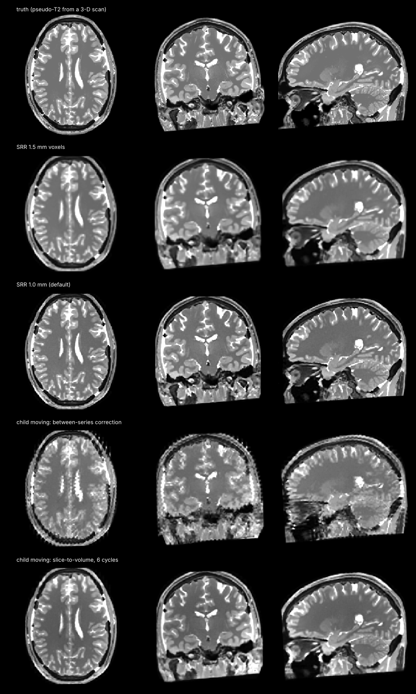
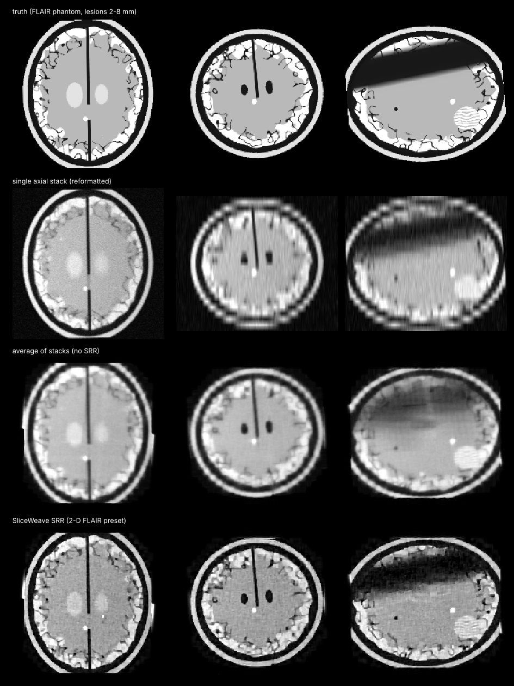
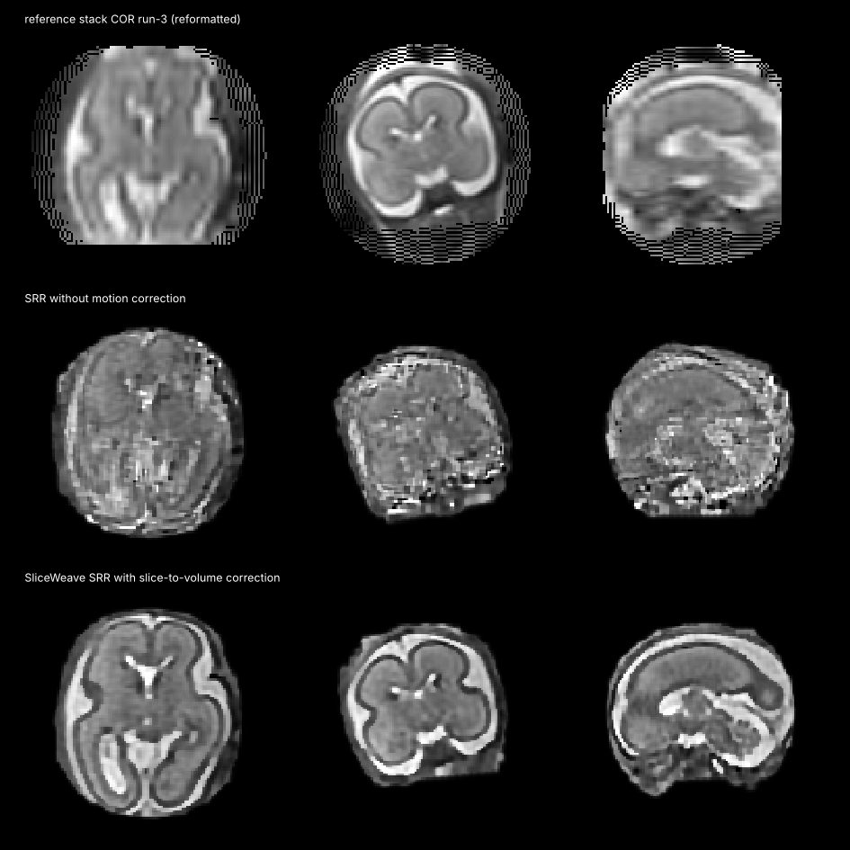

# Validation

Software validation on simulated stacks with known ground truth (single-shot T2 and 2-D FLAIR)
and on one public fetal dataset. **Not a clinical validation**: no reader study, no comparison with other toolkits on the
same data, one real case. All numbers come from `tools/validate.py` (results in
`docs/validation/results.json`, figures next to it) on a 2-core cloud VM, CPU only.

```
python tools/validate.py --out docs/validation \
    --adult-t1 <niivue>/packages/niivue-desktop/resources/images/standard/chris_t1.nii.gz \
    --fetal-dir <mialsuperresolutiontoolkit>/data
```

## Design

* **Simulation is not the reconstruction model.** Stacks are sampled from a finer truth volume
  with a box-shaped slice profile (7 points across the slice thickness) and Gauss-Hermite
  in-plane sampling; SliceWeave assumes a Gaussian slice profile. Rician-like noise (2 % of the
  CSF signal, about 4-5 % of the median tissue signal), a 15 % linear bias field per stack.
* **Metrics** inside the brain (phantoms) or the head (T1 case), after a least-squares intensity
  scale: PSNR, SSIM (Gaussian window 1.5 voxels) and NCC against the truth resampled onto the
  output grid. Baselines: one stack reformatted (trilinear), and the "average" volume
  (PSF-weighted mean of the same motion-corrected slices, no deconvolution).
* Adult protocol: AX, COR, SAG, 0.9 x 0.9 mm pixels, 4 mm slices, 0.4 mm gap, small obliquity,
  rigid head motion between series (up to 5 deg / 5 mm). Output 1.0 mm.
* 2-D FLAIR protocol: AX, COR, SAG of a FLAIR phantom (the adult anatomy with FLAIR contrast and
  12 bright white-matter lesions of 2-8 mm), acquired 192 x 256 over 230 mm (1.2 x 0.9 mm) and
  zero-filled to 512 x 512 (0.45 mm pixels) as scanners do, complex noise added before the
  interpolation (sigma 4.4 % of the white-matter signal), 5 mm slices, 1.5 mm gap, rigid motion
  between series. Output 1.0 mm. Lesion contrast recovery: (value at the lesion centre - median
  of the white matter 2-3.5 radii away) / (true lesion - white-matter difference), after the
  intensity scale; median per size group (4 lesions each).
* Fetal protocol: each orientation twice, 1.1 x 1.1 mm pixels, 3 mm slices, 0.3 mm gap,
  obliquity about 6 deg, interleaved acquisition with smooth random fetal motion (up to about
  6 deg / 3 mm plus sudden jumps; median within-stack motion 3-6 deg), a static maternal
  background, and 2 partly corrupted slices per stack (signal loss over half the slice).
  Output 0.8 mm.

## Results

### Adult, formula phantom (truth 0.6 mm)

| Volume | PSNR (dB) | SSIM | NCC |
|---|---|---|---|
| single axial stack, reformatted | 19.97 | 0.628 | 0.819 |
| average of stacks (no SRR) | 20.25 | 0.669 | 0.835 |
| **SliceWeave SRR** | **23.21** | **0.817** | **0.920** |

Motion between series: true 1.6 deg / 1.6 mm and 3.5 deg / 1.3 mm; residual after correction
0.03 deg / 0.03 mm. Reconstruction 53 s. (Before the weaker final weight of adult T2, see below:
22.45 / 0.807 / 0.902.)


### Adult, real anatomy (0.88 mm 3-D T1 head scan as truth)

The same protocol simulated from a real head scan (T1 contrast; used here as a structural truth,
the contrast does not matter for the reconstruction).

| Volume | PSNR (dB) | SSIM | NCC |
|---|---|---|---|
| single axial stack, reformatted | 22.34 | 0.717 | 0.866 |
| average of stacks (no SRR) | 23.02 | 0.749 | 0.894 |
| **SliceWeave SRR** | **25.78** | **0.897** | **0.945** |

Motion between series: true 0.9 deg / 3.2 mm and 4.9 deg / 5.0 mm; residual 0.09 deg / 0.25 mm
and 0.05 deg / 0.16 mm. Reconstruction 60 s.


### Grey-white matter and sulci, pseudo-T2 from the real head scan

`tools/validate.py --adult-t1 ... --only cortex` (about 45 min). The 0.88 mm head scan is given
T2 contrast by mapping its intensities: adult (grey matter brighter than white matter, CSF bright)
and infant (unmyelinated white matter brighter than grey matter, lower contrast). Child protocol:
AX, COR, SAG, 0.6 x 0.6 mm in-plane, 3 mm slices without gap, 15 % bias, motion between series;
output 1.0 mm unless stated. Tissue labels come from the scan's own intensities. Measures inside
the brain, on voxels with enough data:

* grey-white contrast: (median grey matter - median white matter) in the result / in the truth;
* sulcal CSF contrast: the same for CSF next to the cortex (ventricles and cisterns excluded)
  against grey matter, i.e. how open the sulci are;
* cortex detail: correlation with the truth of the 0.5-2 mm band-pass detail in the cortical
  ribbon (sulcal pattern, edges of gyri);
* PSNR and SSIM in the brain.

Weight of the final volume, as a factor of the noise-calibrated weight (the volumes used for
motion correction keep the full weight). Adult contrast, noise 3 % (calibrated alpha 2.07):

| Factor | PSNR (dB) | SSIM | grey-white | sulcal CSF | cortex detail |
|---|---|---|---|---|---|
| 1.0 (before) | 26.68 | 0.930 | 1.02 | 0.90 | 0.955 |
| 0.5 | 27.39 | 0.948 | 1.03 | 0.96 | 0.967 |
| 0.35 | 27.61 | 0.953 | 1.03 | 0.99 | 0.971 |
| **0.25 (default)** | **27.72** | **0.956** | **1.03** | **1.01** | **0.973** |
| 0.15 | 27.67 | 0.955 | 1.03 | 1.03 | 0.975 |

Other noise levels and the infant contrast, factor 1.0 -> 0.25:

| Case | PSNR (dB) | SSIM | grey-white | sulcal CSF | cortex detail |
|---|---|---|---|---|---|
| adult, noise 1.5 % | 27.47 -> 27.88 | 0.950 -> 0.962 | 1.02 -> 1.02 | 0.97 -> 1.04 | 0.968 -> 0.976 |
| adult, noise 6 % | 25.49 -> 27.11 | 0.895 -> 0.941 | 1.02 -> 1.03 | 0.80 -> 0.95 | 0.932 -> 0.965 |
| infant, noise 3 % | 27.03 -> 27.68 | 0.920 -> 0.943 | 0.50 -> 0.64 | 0.88 -> 0.99 | 0.957 -> 0.972 |

The factor 0.25 was best or within 0.1 dB of the best PSNR in every case and kept the sulci
open; 0.15 opened them slightly more at a small cost in PSNR / SSIM except at 6 % noise.
The adult grey-white contrast (large regions) was kept at every weight; the strong weight removed
the fine detail. The low infant grey-white contrast is only partly recovered (0.64; 0.69 at 0.15)
with 3 mm slices.

Output voxel size (factor 0.25, adult, noise 3 %):

| Voxel | PSNR (dB) | SSIM | grey-white | sulcal CSF | cortex detail | time |
|---|---|---|---|---|---|---|
| 1.5 mm | 25.94 | 0.943 | 1.05 | 0.92 | 0.911 | 31 s |
| **1.0 mm (default)** | **27.72** | **0.956** | **1.03** | **1.01** | **0.973** | **96 s** |
| 0.8 mm | 27.71 | 0.942 | 1.03 | 1.00 | 0.977 | 131 s |

1.5 mm voxels blur the cortex; 0.8 mm gave no more than 1.0 mm with these 0.6 x 0.6 x 3 mm
stacks (slightly more detail, more noise, 40 % more time).

A child moving during every series: smooth drift up to 3 deg / 2 mm over each series plus one
sudden jump, interleaved slice order; the reference stack moved too, so each result was rigidly
aligned to the truth before the comparison:

| Motion correction | slice position error (mm) | PSNR (dB) | SSIM | sulcal CSF | cortex detail | time |
|---|---|---|---|---|---|---|
| between series, 1 cycle | 2.56 -> 1.83 | 18.75 | 0.587 | 0.49 | 0.48 | 125 s |
| **slice-to-volume, 6 cycles** | **2.56 -> 0.23** | **21.82** | **0.911** | **0.87** | **0.93** | **522 s** |

With motion during the series the cortex is smeared and doubled whatever the weight or voxel
size; slice-to-volume correction restored most of it. (The grey-white contrast, 1.20 after
slice-to-volume correction, is not reliable here: the labels and the scale fit assume the
alignment to the truth is exact.)



### 2-D FLAIR, formula phantom with lesions (truth 0.6 mm)

| Volume | PSNR (dB) | SSIM | NCC | lesion contrast 2-3 / 4-5 / 6-8 mm |
|---|---|---|---|---|
| single axial stack, reformatted | 15.70 | 0.510 | 0.701 | 0.16 / 0.50 / 0.72 |
| average of stacks (no SRR) | 16.11 | 0.595 | 0.741 | 0.09 / 0.53 / 0.71 |
| **SliceWeave SRR (FLAIR preset)** | **17.91** | **0.679** | **0.840** | **0.38 / 1.24 / 1.13** |
| SRR, noise-calibrated weight of the other modes | 18.40 | 0.735 | 0.853 | 0.24 / 1.19 / 1.14 |
| SRR, pixel size taken as resolution (same weights) | 18.35 | 0.696 | 0.852 | 0.35 / 1.18 / 1.14 |
| truth on the 1 mm output grid | - | - | - | 0.90 / 1.00 / 1.00 |

Noise estimated at 0.044 of the median tissue signal (all three stacks); alpha 2.95 for the
registration targets, 1.03 for the final volume. Motion between series: true 3.6 deg / 0.8 mm
and 2.8 deg / 2.3 mm; residual 0.10 deg / 0.15 mm and 0.05 deg / 0.08 mm. Reconstruction 58 s.

Reading:

* SRR recovers the contrast of lesions of 4 mm and more (values slightly above 1 are overshoot at
  the lesion centre from the deconvolution), where a single 5 mm stack or the plain average keeps
  about half of it. Lesions of 2-3 mm keep about 40 % of their contrast (90 % is the most a 1 mm
  grid can hold): better than one stack (16 %) or the average (9 %), but small lesions are still
  softened. Read lesions on the acquired series.
* The FLAIR weight trades 0.5 dB PSNR and 0.06 SSIM (mostly noise) for 1.6 x the contrast of
  2-3 mm lesions.
* Modelling the acquired resolution (1.2 x 0.9 mm instead of the 0.45 mm pixels) matters most
  through the noise estimate, which sets the weight; with the same weights the PSF alone changed
  PSNR / SSIM and lesion contrast by small amounts in opposite directions.



### Fetal, formula phantom with slice motion (truth 0.6 mm)

| Volume | PSNR (dB) | SSIM | NCC | slice pose error (mm) | slices used |
|---|---|---|---|---|---|
| SRR without motion correction | 17.86 | 0.404 | 0.418 | 4.02 | 119 / 169 |
| average after SliceWeave motion correction | 21.14 | 0.672 | 0.695 | 1.93 | 155 / 169 |
| **SliceWeave SRR** | **22.91** | **0.748** | **0.824** | **1.93** | 155 / 169 |
| SRR with the true motion (upper bound) | 25.47 | 0.789 | 0.885 | 0 | all |

Slice pose error: median over slices of the mean distance between estimated and true positions
of 7 points within 30 mm of the slice centre, after the best global rigid alignment. Volumes
are compared after rigid alignment to the truth. Reconstruction 206 s.

Reading: motion correction is what makes fetal SRR possible (without it the SRR is worse than a
plain average). SliceWeave halves the slice pose error and recovers about two thirds of the gap
between no correction and perfect motion knowledge (PSNR 17.9 -> 22.9 of 25.5 dB; SSIM 0.40 ->
0.75 of 0.79). The remaining error is mostly out-of-plane rotation of single slices, which one
slice constrains weakly.


### Fetal, public real data (1.5 T HASTE, 6 stacks, manual brain masks)

Sample dataset of the MIAL Super-Resolution Toolkit (sub-01: AX, COR, SAG twice; 1.125 x 1.125
mm pixels, 3 mm slices, 3.3 mm spacing, 22 slices each). No ground truth: the check is
slice-to-volume consistency, the NCC between each acquired slice and the same slice simulated
from the reconstructed volume (inside the brain mask).

| | median slice NCC | 10th percentile | slices used | time |
|---|---|---|---|---|
| without motion correction | 0.687 | 0.566 | 126 / 130 | 17 s |
| **SliceWeave (slice-to-volume)** | **0.969** | **0.954** | 130 / 130 | 99 s |

Since 1.1.0 the acquired in-plane resolution is modelled: the dcm2niix sidecars give 224
phase-encoding lines reconstructed to 320, so 1.61 x 1.125 mm (v1.0.0 assumed the 1.125 mm
pixels: 0.973 / 0.955). Estimated stack motion relative to the reference (COR run-3, chosen
automatically as the stack with the least motion): AX 4.2 deg / 7.0 mm and 6.4 deg / 6.2 mm, COR
3.5 deg / 2.0 mm, SAG 20.3 deg / 6.6 mm and 20.7 deg / 8.1 mm (v1.0.0: within 0.3 deg / 0.04 mm
of these). Consistency is measured against a volume built from the
same slices, so it shows that the motion estimates make the slices agree with each other; it is
not an accuracy measure. Visually (figure), the corrected reconstruction shows the lateral
ventricles, the cortical ribbon, the corpus callosum and the cerebellum without the slice
misregistration of the uncorrected one.



## Number of cycles

`tools/validate.py --only cycles`: the same simulated stacks reconstructed with different numbers
of motion-correction cycles (defaults otherwise).

Fetal phantom, slice-to-volume (the stacks of the fetal phantom case above):

| Cycles | PSNR (dB) | SSIM | NCC | slice position error (mm) | slices used | time (s) |
|---|---|---|---|---|---|---|
| 1 | 18.43 | 0.483 | 0.548 | 3.28 | 84 / 169 | 101 |
| 2 | 21.56 | 0.672 | 0.751 | 2.65 | 149 / 169 | 138 |
| 3 | 22.20 | 0.711 | 0.788 | 2.40 | 151 / 169 | 151 |
| 4 | 22.48 | 0.727 | 0.804 | 2.23 | 151 / 169 | 164 |
| **6 (default)** | **22.91** | **0.748** | **0.824** | **1.93** | **155 / 169** | **203** |
| 8 | 23.28 | 0.765 | 0.841 | 1.61 | 155 / 169 | 204 |

Slice position error before correction 4.02 mm; without motion correction 17.86 dB / 0.404; with
the true motion 25.47 dB / 0.789. One cycle registers stacks and packets only and keeps the
lowest outlier threshold against a still blurred volume, so half of the slices are excluded.
The gain continues to 8 cycles on this phantom; the default stays 6, the setting used on the
real fetal data.

Adult phantom, motion between series (true 1.6 deg / 1.6 mm and 3.5 deg / 1.3 mm):

| Cycles | PSNR (dB) | SSIM | residual motion (max) | time (s) |
|---|---|---|---|---|
| 0 | 22.45 | 0.807 | 0.031 deg / 0.031 mm | 54 |
| **1 (default)** | **22.45** | **0.807** | **0.031 deg / 0.031 mm** | **60** |
| 2 | 22.38 | 0.804 | 0.031 deg / 0.031 mm | 78 |
| 3 | 22.33 | 0.804 | 0.031 deg / 0.031 mm | 95 |

The registration to the reference stack was already accurate; the cycle re-checks it against the
super-resolved volume and matters when the first registration is off (large movement between
series, a poor reference stack).

## Regularisation

The automatic regularisation (`alpha = 0.1 + 65 x relative noise`, Huber penalty) was chosen on
an earlier version of the adult phantom (truth 1 mm, without stack motion) at four noise levels
(0.5, 1, 2 and 4 % of the CSF signal; alpha 0.1-10) by the alpha that maximised PSNR and SSIM
together: about 0.5-1 at 0.5 %, 1-3 at 1 %, about 3 at 2 % and 3-10 at 4 % (PSNR peaked at the
lower, SSIM at the higher value); the formula gives 0.85, 1.6, 3.1 and 6.1. The noise estimate (Immerkaer Laplacian, relative to the median tissue signal) matched the
simulated noise within about 10 % at 2 %. On zero-filled (interpolated) images the noise is
estimated at the acquired spacing; at the pixel level it read 0.004 instead of 0.044 on the FLAIR
phantom. A fixed alpha can be set in the viewer or with `--alpha`.

The calibration looked at the whole image of a phantom with smooth anatomy. For the final volume
the presets use part of this weight; the volumes used as registration targets keep all of it (a
noisier target makes the motion estimates worse):

* adult / paediatric T2: 0.25 x (on real anatomy this kept the sulci and the cortical ribbon and
  improved PSNR / SSIM at 1.5-6 % noise; see "Grey-white matter and sulci");
* FLAIR: 0.35 x (FLAIR is read for small focal lesions; lesion contrast of 2-3 mm lesions about
  1.5 x higher for a small loss of PSNR and SSIM; see the FLAIR table);
* fetal: 1.0 x (unchanged; not yet tested on real fetal anatomy with truth).

## Tests run on every build

`pytest` (38 tests): rotation algebra, operator/adjoint dot test, registration recovers a known
3D motion (< 0.2 deg / 0.2 mm), SRR beats the average and recovers between-series motion
(< 0.5 deg / 0.5 mm), DICOM write/read geometry, NIfTI round trip and JSON sidecar thickness,
DICOM decoding (implicit, big-endian, RLE), case ID and de-identification rules, server login /
CSRF / Host / CSP, an API import-to-viewer round trip, the network guard and the static network
audit, FLAIR recognition (names, sequence, TI/TE; HASTE not taken for FLAIR), acquired
resolution from DICOM and from sidecars, the PSF following the acquired resolution, the noise
estimate on zero-filled images, the FLAIR preset refusing slice-to-volume correction, the plan
switching stacks and warning on mixed contrasts, the cycle schedule (registration and
intensity / outlier passes for each setting), the warning for a coarse output voxel, cycles
following the motion correction, the brain window, the DICOM export windows and the weaker final
weight of adult T2. `sliceweave selftest` (DICOM round trip, FLAIR
recognition, adult phantom end-to-end) runs on Windows from source and inside the built
executable with outbound network traffic blocked.

## Not yet validated

* Clinical image quality (reader study), paediatric data, 3 T data, other vendors' single-shot
  sequences.
* 2-D FLAIR on patient data (phantom only so far): lesion detection and conspicuity against the
  acquired series, inflow and CSF-pulsation artefacts, motion within a multi-shot series.
* Comparison against NiftyMIC / SVRTK / NeSVoR on the same stacks.
* Robustness to severe fetal motion (large rotations within a stack) and to poor region placement.
* Quantitative accuracy of measurements (biometry, volumetry) on the reconstructed volumes.
