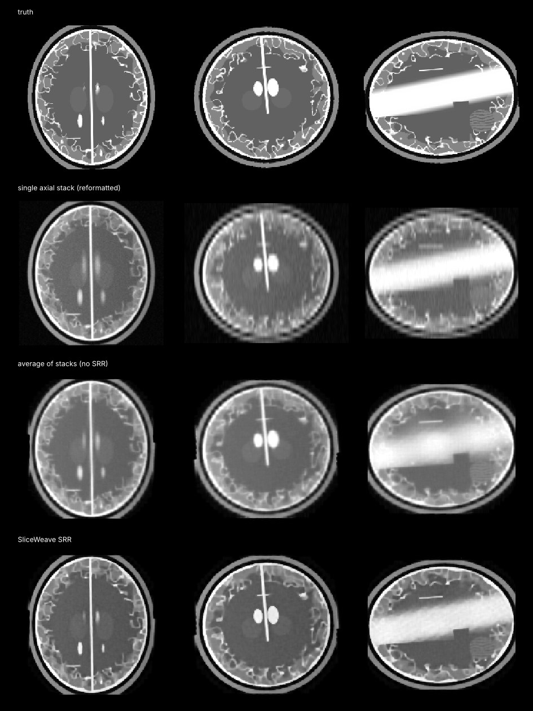
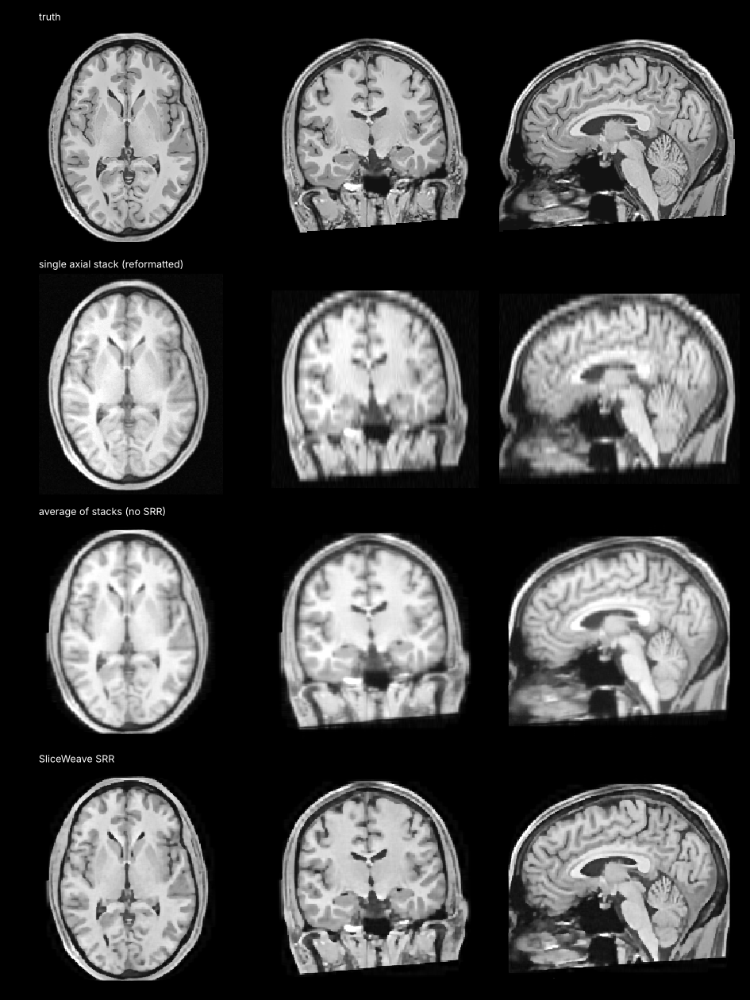
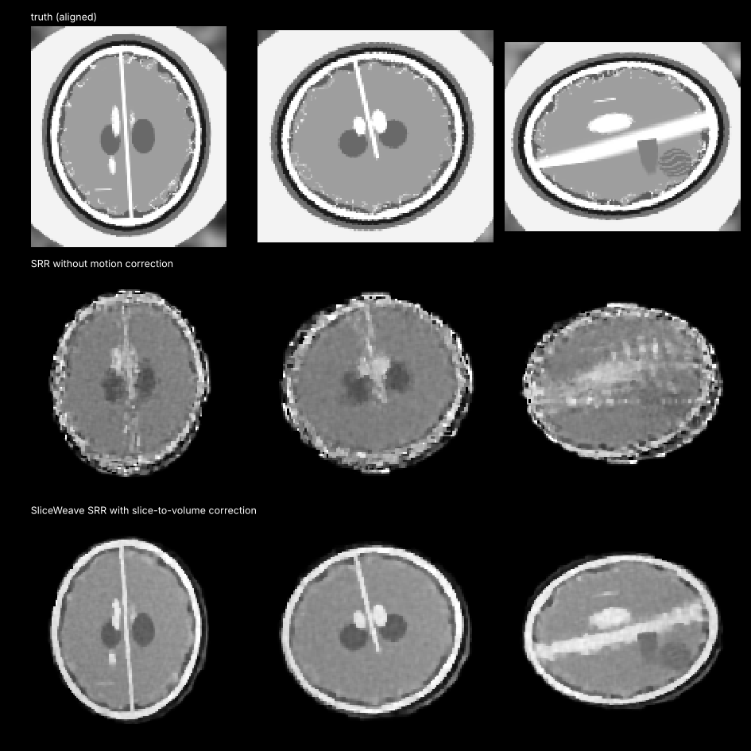

# Validation

Software validation on simulated stacks with known ground truth and on one public fetal
dataset. **Not a clinical validation**: no reader study, no comparison with other toolkits on the
same data, one real case. All numbers come from `tools/validate.py` (results in
`docs/validation/results.json`, figures next to it) on a 2-core cloud VM, CPU only.

```
python tools/validate.py --out docs/validation \
    --adult-t1 <niivue>/packages/niivue-desktop/resources/images/standard/chris_t1.nii.gz \
    --fetal-dir <mialsuperresolutiontoolkit>/data
```

## Design

* **Simulation is not the reconstruction model.** Stacks are sampled from a finer truth volume
  with a box-shaped slice profile (7 points across the slice thickness) and Gauss-Hermite
  in-plane sampling; SliceWeave assumes a Gaussian slice profile. Rician-like noise (2 % of the
  CSF signal, about 4-5 % of the median tissue signal), a 15 % linear bias field per stack.
* **Metrics** inside the brain (phantoms) or the head (T1 case), after a least-squares intensity
  scale: PSNR, SSIM (Gaussian window 1.5 voxels) and NCC against the truth resampled onto the
  output grid. Baselines: one stack reformatted (trilinear), and the "average" volume
  (PSF-weighted mean of the same motion-corrected slices, no deconvolution).
* Adult protocol: AX, COR, SAG, 0.9 x 0.9 mm pixels, 4 mm slices, 0.4 mm gap, small obliquity,
  rigid head motion between series (up to 5 deg / 5 mm). Output 1.0 mm.
* Fetal protocol: each orientation twice, 1.1 x 1.1 mm pixels, 3 mm slices, 0.3 mm gap,
  obliquity about 6 deg, interleaved acquisition with smooth random fetal motion (up to about
  6 deg / 3 mm plus sudden jumps; median within-stack motion 3-6 deg), a static maternal
  background, and 2 partly corrupted slices per stack (signal loss over half the slice).
  Output 0.8 mm.

## Results

### Adult, formula phantom (truth 0.6 mm)

| Volume | PSNR (dB) | SSIM | NCC |
|---|---|---|---|
| single axial stack, reformatted | 19.97 | 0.628 | 0.819 |
| average of stacks (no SRR) | 20.25 | 0.669 | 0.835 |
| **SliceWeave SRR** | **22.45** | **0.807** | **0.902** |

Motion between series: true 1.6 deg / 1.6 mm and 3.5 deg / 1.3 mm; residual after correction
0.03 deg / 0.03 mm. Reconstruction 68 s.



### Adult, real anatomy (0.88 mm 3-D T1 head scan as truth)

The same protocol simulated from a real head scan (T1 contrast; used here as a structural truth,
the contrast does not matter for the reconstruction).

| Volume | PSNR (dB) | SSIM | NCC |
|---|---|---|---|
| single axial stack, reformatted | 22.34 | 0.717 | 0.866 |
| average of stacks (no SRR) | 23.02 | 0.749 | 0.894 |
| **SliceWeave SRR** | **25.76** | **0.895** | **0.942** |

Motion between series: true 0.9 deg / 3.2 mm and 4.9 deg / 5.0 mm; residual 0.09 deg / 0.25 mm
and 0.05 deg / 0.16 mm. Reconstruction 103 s.



### Fetal, formula phantom with slice motion (truth 0.6 mm)

| Volume | PSNR (dB) | SSIM | NCC | slice pose error (mm) | slices used |
|---|---|---|---|---|---|
| SRR without motion correction | 17.86 | 0.404 | 0.418 | 4.02 | 119 / 169 |
| average after SliceWeave motion correction | 21.14 | 0.672 | 0.695 | 1.93 | 155 / 169 |
| **SliceWeave SRR** | **22.91** | **0.748** | **0.824** | **1.93** | 155 / 169 |
| SRR with the true motion (upper bound) | 25.47 | 0.789 | 0.885 | 0 | all |

Slice pose error: median over slices of the mean distance between estimated and true positions
of 7 points within 30 mm of the slice centre, after the best global rigid alignment. Volumes
are compared after rigid alignment to the truth. Reconstruction 206 s.

Reading: motion correction is what makes fetal SRR possible (without it the SRR is worse than a
plain average). SliceWeave halves the slice pose error and recovers about two thirds of the gap
between no correction and perfect motion knowledge (PSNR 17.9 -> 22.9 of 25.5 dB; SSIM 0.40 ->
0.75 of 0.79). The remaining error is mostly out-of-plane rotation of single slices, which one
slice constrains weakly.



### Fetal, public real data (1.5 T HASTE, 6 stacks, manual brain masks)

Sample dataset of the MIAL Super-Resolution Toolkit (sub-01: AX, COR, SAG twice; 1.125 x 1.125
mm pixels, 3 mm slices, 3.3 mm spacing, 22 slices each). No ground truth: the check is
slice-to-volume consistency, the NCC between each acquired slice and the same slice simulated
from the reconstructed volume (inside the brain mask).

| | median slice NCC | 10th percentile | slices used | time |
|---|---|---|---|---|
| without motion correction | 0.694 | 0.578 | 126 / 130 | 16 s |
| **SliceWeave (slice-to-volume)** | **0.973** | **0.955** | 130 / 130 | 113 s |

Estimated stack motion relative to the reference (COR run-3, chosen automatically as the stack
with the least motion): AX 4.4 deg / 7.0 mm and 6.7 deg / 6.2 mm, COR 3.6 deg / 1.9 mm, SAG
20.5 deg / 6.6 mm and 20.6 deg / 8.1 mm. Consistency is measured against a volume built from the
same slices, so it shows that the motion estimates make the slices agree with each other; it is
not an accuracy measure. Visually (figure), the corrected reconstruction shows the lateral
ventricles, the cortical ribbon, the corpus callosum and the cerebellum without the slice
misregistration of the uncorrected one.


## Regularisation

The automatic regularisation (`alpha = 0.1 + 65 x relative noise`, Huber penalty) was chosen on
an earlier version of the adult phantom (truth 1 mm, without stack motion) at four noise levels
(0.5, 1, 2 and 4 % of the CSF signal; alpha 0.1-10) by the alpha that maximised PSNR and SSIM
together: about 0.5-1 at 0.5 %, 1-3 at 1 %, about 3 at 2 % and 3-10 at 4 % (PSNR peaked at the
lower, SSIM at the higher value); the formula gives 0.85, 1.6, 3.1 and 6.1. The noise estimate (Immerkaer Laplacian, relative to the median tissue signal) matched the
simulated noise within about 10 % at 2 %. A fixed alpha can be set in the viewer or with
`--alpha`.

## Tests run on every build

`pytest` (21 tests): rotation algebra, operator/adjoint dot test, registration recovers a known
3D motion (< 0.2 deg / 0.2 mm), SRR beats the average and recovers between-series motion
(< 0.5 deg / 0.5 mm), DICOM write/read geometry, NIfTI round trip and JSON sidecar thickness,
DICOM decoding (implicit, big-endian, RLE), case ID and de-identification rules, server login /
CSRF / Host / CSP, an API import-to-viewer round trip, the network guard and the static network
audit. `sliceweave selftest` (DICOM round trip, adult phantom end-to-end) runs on Windows from
source and inside the built executable with outbound network traffic blocked.

## Not yet validated

* Clinical image quality (reader study), paediatric data, 3 T data, other vendors' single-shot
  sequences.
* Comparison against NiftyMIC / SVRTK / NeSVoR on the same stacks.
* Robustness to severe fetal motion (large rotations within a stack) and to poor region placement.
* Quantitative accuracy of measurements (biometry, volumetry) on the reconstructed volumes.
